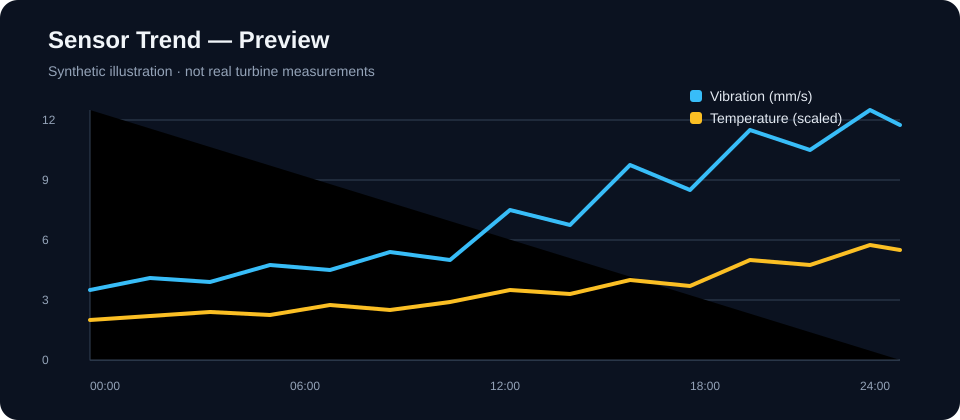
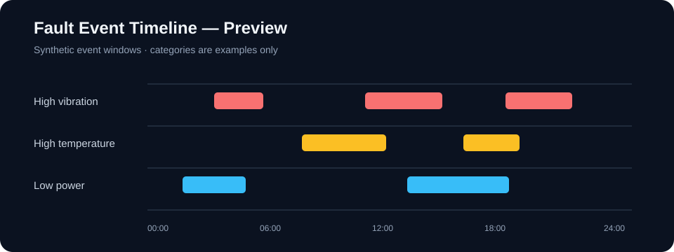
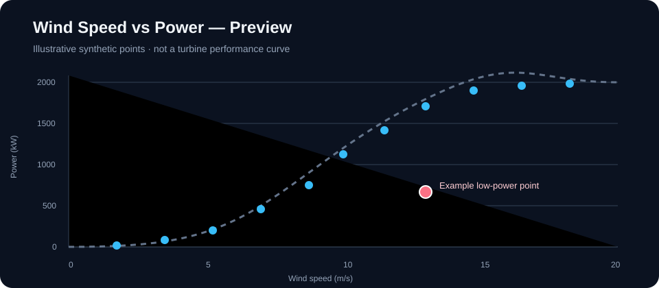

# Wind Turbine Sensor Data Analysis & Fault Detection

A Python-based condition-monitoring project concept for exploring wind-turbine sensor telemetry, identifying abnormal operating patterns, and supporting predictive-maintenance analysis.

> **Data transparency:** The visualizations below are illustrative previews created with synthetic example values. They are not output from a completed or validated analysis pipeline, and they do not represent measurements from a real turbine.

## Preview outputs

### Sensor trends

### Fault event timeline

### Wind speed versus power

## Planned analysis workflow

1. Load timestamped turbine telemetry from CSV.
2. Validate schema, units, timestamps, missing values, and sensor ranges.
3. Apply configurable rule-based checks for vibration, temperature, rotor speed, and power.
4. Calculate rolling statistical anomaly scores.
5. Export a fault-labeled dataset, summary metrics, plots, and a Markdown report.

## Example sensor fields

| Field | Unit |
|---|---|
| timestamp | ISO-8601 |
| wind_speed_mps | m/s |
| rotor_speed_rpm | RPM |
| generator_speed_rpm | RPM |
| temperature_c | °C |
| vibration_mm_s | mm/s |
| power_kw | kW |
| torque_nm | N·m |
| pitch_angle_deg | degrees |

## Methodology notes

- Thresholds must be turbine- and sensor-specific; example values are not universal engineering limits.
- A rule or statistical anomaly indicates a **potential abnormal condition**, not a confirmed component failure.
- Synthetic examples are useful for testing code paths but cannot establish field performance.
- Validation with documented real SCADA data and domain-approved operating limits is required before operational use.

## Repository status

The repository currently contains README documentation and illustrative preview graphics. The analysis pipeline, reproducible dataset, automated tests, and report-generation workflow still need to be implemented and verified before this project can be described as a completed proof of work.

## Author

**Mhetre Prajwal Kalidas**  
GitHub: [@PrajwalMhetre](https://github.com/PrajwalMhetre)
