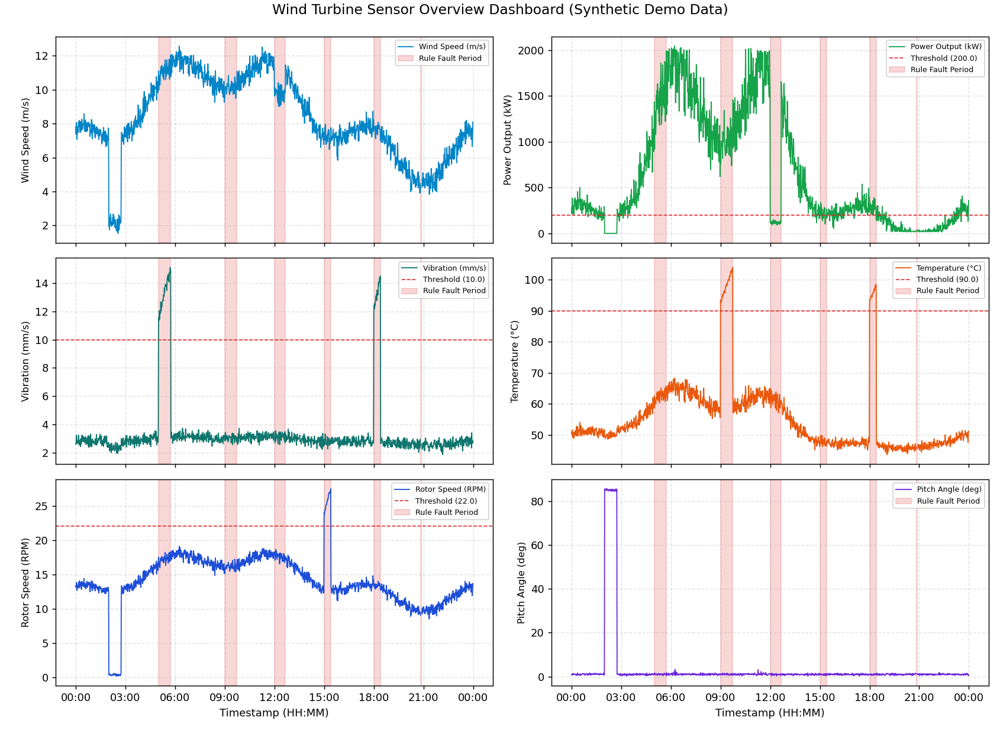
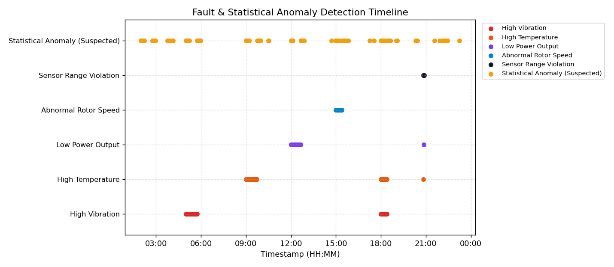
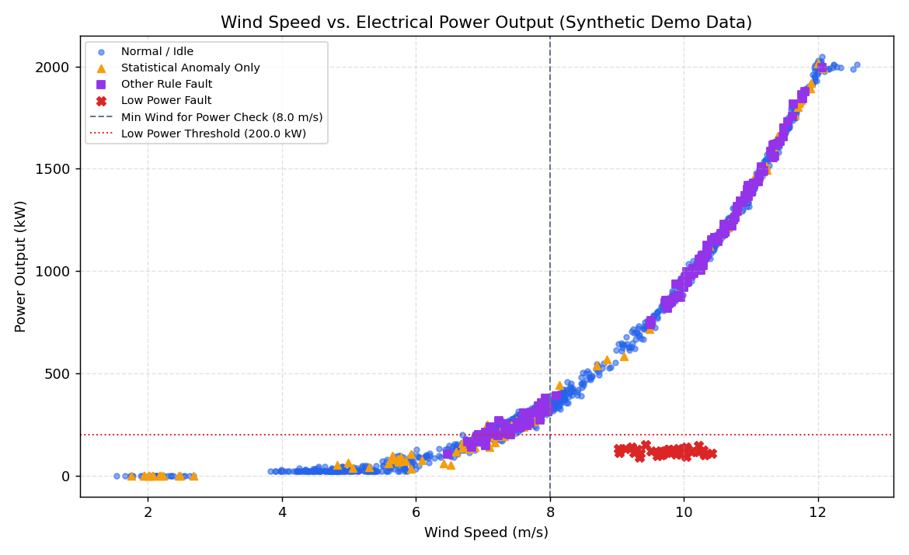
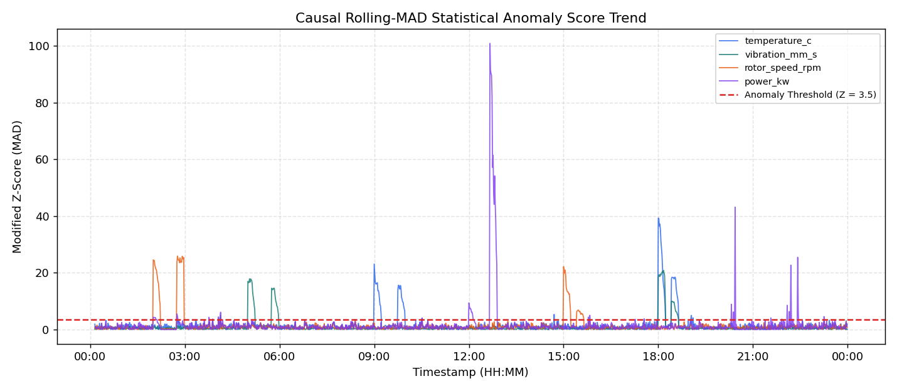

# Wind Turbine Sensor Data Analysis & Fault Detection

A modular, reproducible Python condition-monitoring proof-of-concept for analyzing wind turbine SCADA-like sensor data, auditing data quality, detecting rule-based operating faults, scoring statistical anomalies, and generating automated engineering reports and visualizations.

> **Important Scope Notice:** The demonstration dataset included in this repository is **synthetically generated** (`seed=42`) to showcase fault and data-quality scenarios. All configured thresholds in `config/thresholds.json` are **illustrative engineering assumptions**, not universal OEM turbine specifications. This project has not been deployed on a live wind turbine or validated against industrial SCADA telemetry.

---

## Problem Statement

Modern wind turbines generate continuous multivariate time-series telemetry across wind, rotor, drivetrain, thermal, vibration, and electrical subsystems. Raw sensor feeds frequently suffer from missing readings, duplicate timestamps, and physically impossible sensor glitches, while early-stage mechanical or electrical degradation can manifest as threshold breaches or subtle statistical deviations. Without an automated, auditable pipeline, operators risk either missing developing faults or reacting to false alarms during normal low-wind idle periods.

## Objectives

- Load and validate wind turbine sensor CSV files against a strict schema.
- Audit data quality (missing values, non-numeric entries, duplicate timestamps, and out-of-range physical readings) without silently deleting or masking raw data.
- Detect potential operating faults using configurable engineering rules while avoiding false positives during low-wind/idle states.
- Compute causal (zero look-ahead leakage) rolling-median / Median Absolute Deviation (MAD) statistical anomaly scores.
- Clearly separate **rule-based fault flags** from **statistical anomaly scores** (suspected unusual conditions, not confirmed mechanical failures).
- Automatically export processed CSV results, machine-readable JSON summaries, Markdown engineering reports, and Matplotlib diagnostic plots.

## Key Features

- **Strict Schema & Data-Quality Auditing:** Validates required columns, parses timestamps, tracks non-numeric coercions, flags duplicate timestamps, and checks physical sensor bounds.
- **Transparent Preprocessing:** Configurable duplicate-handling (`keep_first`, `keep_last`, `flag_only`) and missing-value policies (`retain` by default to avoid hiding sensor dropouts).
- **Configurable Rule-Based Fault Engine:** Evaluates High Vibration, High Temperature, Low Power Output (conditioned on operating state and sufficient wind), Abnormal Rotor Speed, and Sensor Range Violations, supporting multiple simultaneous faults per timestamp.
- **Causal Statistical Anomaly Detection:** Uses a past-only rolling median and MAD modified Z-score with zero-MAD fallback and out-of-range baseline masking.
- **Automated Reporting & Headless Plotting:** Produces 7 PNG engineering charts, `reports/summary.json`, and `reports/analysis_report.md` directly from actual pipeline outputs.

## System Architecture

```text
Wind-Turbine-Sensor-Data-Analysis-Fault-Detection/
├── config/
│   └── thresholds.json                 # Configurable rules, anomaly, preprocessing & physical limits
├── data/
│   ├── raw/
│   │   └── wind_turbine_sensor_data.csv
│   └── processed/
│       └── fault_detection_results.csv
├── reports/
│   ├── analysis_report.md
│   ├── summary.json
│   └── figures/
│       ├── 01_wind_speed_vs_power.png
│       ├── 02_vibration_trend.png
│       ├── 03_temperature_trend.png
│       ├── 04_rotor_speed_trend.png
│       ├── 05_fault_detection_timeline.png
│       ├── 06_sensor_overview_dashboard.png
│       └── 07_anomaly_score_trend.png
├── scripts/
│   ├── generate_demo_data.py           # CLI: deterministic synthetic dataset generator
│   └── run_analysis.py                 # CLI: end-to-end analysis pipeline
├── src/wind_faults/
│   ├── __init__.py
│   ├── config.py                       # Typed dataclasses & JSON config loader
│   ├── data_loader.py                  # CSV loading & schema validation
│   ├── data_quality.py                 # Quality checks & dq_* indicator columns
│   ├── preprocessing.py                # Chronological sorting & transparent cleaning
│   ├── fault_detection.py              # Configurable rule-based fault engine
│   ├── anomaly_detection.py            # Causal rolling-median / MAD detector
│   ├── synthetic_data.py               # Reproducible synthetic generator + scenario manifest
│   ├── visualization.py                # Headless Matplotlib PNG plotting
│   ├── reporting.py                    # summary.json & analysis_report.md builder
│   └── pipeline.py                     # End-to-end orchestration
├── tests/
│   ├── test_data_loader.py
│   ├── test_data_quality.py
│   ├── test_fault_detection.py
│   ├── test_anomaly_detection.py
│   └── test_pipeline.py
├── pyproject.toml
├── requirements.txt
├── LICENSE
└── README.md
```

## Dataset Schema

| Column | Description | Unit / Type |
| --- | --- | --- |
| `timestamp` | Sensor measurement timestamp | ISO / `YYYY-MM-DD HH:MM:SS` |
| `wind_speed_mps` | Wind speed | m/s (`float`) |
| `rotor_speed_rpm` | Rotor rotational speed | RPM (`float`) |
| `generator_speed_rpm` | Generator rotational speed | RPM (`float`) |
| `temperature_c` | Operating temperature | °C (`float`) |
| `vibration_mm_s` | Vibration velocity | mm/s (`float`) |
| `power_kw` | Electrical power output | kW (`float`) |
| `torque_nm` | Generator / drivetrain torque | Nm (`float`) |
| `pitch_angle_deg` | Blade pitch angle | deg (`float`) |
| `status` | Operating state (e.g., `OPERATING`, `IDLE`) | `str` |

## Fault Detection Methodology

Rule-based checks evaluate each timestamp independently against `config/thresholds.json`, allowing multiple simultaneous fault categories to be recorded:

1. **High Vibration (`HIGH_VIBRATION`):** `vibration_mm_s > 10.0` mm/s (`WARNING` or `CRITICAL` at ≥ 12.5 mm/s).
2. **High Temperature (`HIGH_TEMPERATURE`):** `temperature_c > 90.0` °C (`WARNING` or `CRITICAL` at ≥ 100.0 °C).
3. **Low Power Output (`LOW_POWER_OUTPUT`):** Triggered only when `status == "OPERATING"` and `wind_speed_mps >= 8.0` m/s while `power_kw < 200.0` kW, preventing false alarms during normal low-wind or `IDLE` periods.
4. **Abnormal Rotor Speed (`ABNORMAL_ROTOR_SPEED`):** Rotor speed outside `[4.0, 22.0]` RPM while `OPERATING`, or any overspeed `> 22.0` RPM.
5. **Sensor Range Violation (`SENSOR_RANGE_VIOLATION`):** Any reading outside configured physical sensor bounds.

## Statistical Anomaly Detection Methodology

The statistical detector (`src/wind_faults/anomaly_detection.py`) computes a **causal rolling modified Z-score** for `temperature_c`, `vibration_mm_s`, `rotor_speed_rpm`, and `power_kw`:

$$Z_t = \frac{|x_t - \text{median}(x_{t-w+1:t})|}{1.4826 \cdot \text{MAD}(x_{t-w+1:t})}$$

- **Zero Look-Ahead Leakage:** Uses past-only windows (`center=False`, default `rolling_window=30`, `min_periods=10`).
- **Robustness:** Handles `NaN` values gracefully, excludes physically impossible readings from the rolling baseline, and falls back to rolling standard deviation (bounded below by `epsilon`) when `MAD == 0` to prevent division-by-zero spikes.
- **Interpretation:** Scores `>= 3.5` set `is_statistical_anomaly = True` as a **suspected abnormal condition** for engineering review, never as a confirmed mechanical failure.

## Installation

```bash
git clone https://github.com/PrajwalMhetre/Wind-Turbine-Sensor-Data-Analysis-Fault-Detection.git
cd Wind-Turbine-Sensor-Data-Analysis-Fault-Detection

python -m venv .venv
source .venv/bin/activate
pip install -r requirements.txt
```

## Execution

Generate the deterministic synthetic dataset (`1,442` raw rows including `2` documented duplicate timestamps):

```bash
python scripts/generate_demo_data.py
```

Run the full condition-monitoring pipeline:

```bash
python scripts/run_analysis.py
```

Optional CLI arguments for custom SCADA CSVs or output directories:

```bash
python scripts/run_analysis.py --input path/to/scada.csv --output-dir path/to/output --config config/thresholds.json
```

## Testing

```bash
pytest -v
```

The test suite verifies CSV loading, missing columns, invalid types, missing values, duplicate timestamps, all rule-based fault categories, simultaneous faults, causal rolling-MAD scoring, invalid window configuration, and end-to-end pipeline execution.

## Example Outputs (Synthetic Demo Run, `seed=42`)

- **Raw Records Loaded:** `1,442` (`2` duplicate timestamps removed -> `1,440` analyzed)
- **Data-Quality Findings:** `12` missing values retained as `NaN`; `4` physical sensor range violations flagged
- **Rule-Based Faults:** `184` faulty timestamps (`211` fault events; `27` timestamps with simultaneous faults):
  - `HIGH_VIBRATION`: `70`
  - `HIGH_TEMPERATURE`: `71`
  - `LOW_POWER_OUTPUT`: `41`
  - `ABNORMAL_ROTOR_SPEED`: `25`
  - `SENSOR_RANGE_VIOLATION`: `4`
- **Statistical Anomalies:** `192` suspected anomalous timestamps (`z_threshold = 3.5`)
- **Generated Artifacts:** `data/processed/fault_detection_results.csv`, `reports/summary.json`, `reports/analysis_report.md`, and 7 PNG figures in `reports/figures/`.

## Visualization Previews

| Sensor Overview Dashboard | Fault & Anomaly Timeline |
| --- | --- |
|  |  |

| Wind Speed vs. Power Output | Statistical Anomaly Score Trend |
| --- | --- |
|  |  |

## Limitations

- Evaluated only on synthetic demonstration data; not yet validated on real industrial SCADA telemetry.
- Fixed univariate thresholds do not model site-specific air density, turbulence intensity, or multivariate power-curve residuals.
- Causal rolling MAD adapts to local windows, so very slow multi-hour drift may be absorbed into the baseline.

## Future Improvements

- Calibrate thresholds and binned power-curve residuals using historical normal-operation SCADA data.
- Add optional Parquet/SQLite ingestion and multi-turbine fleet comparison.
- Integrate turbine yaw/blade-pitch correlation checks and maintenance-log feedback loops.

## Author

- **Mhetre Prajwal Kalidas**
- **GitHub:** [https://github.com/PrajwalMhetre](https://github.com/PrajwalMhetre)
