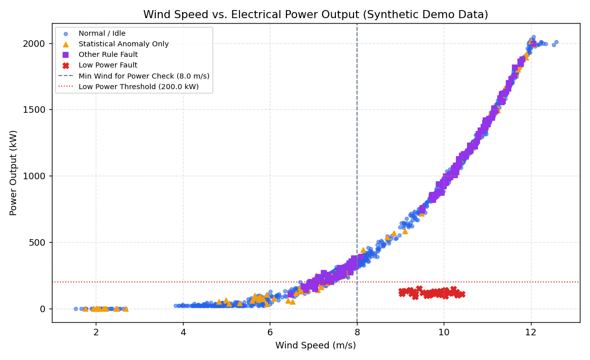
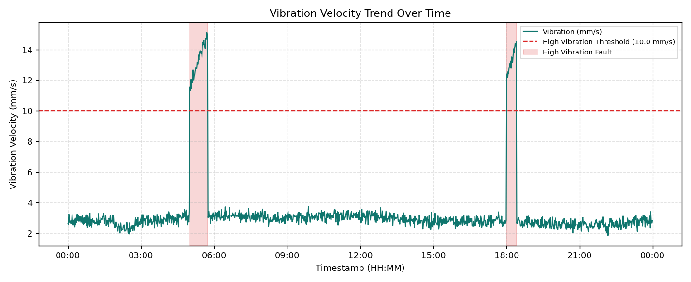
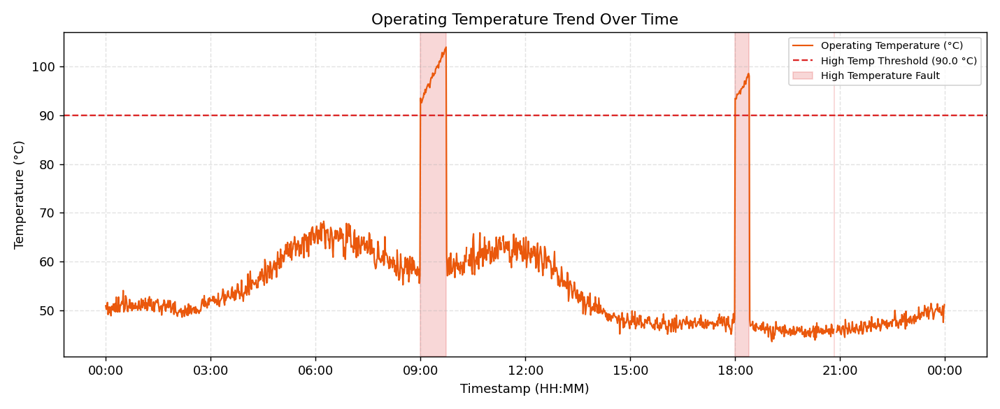
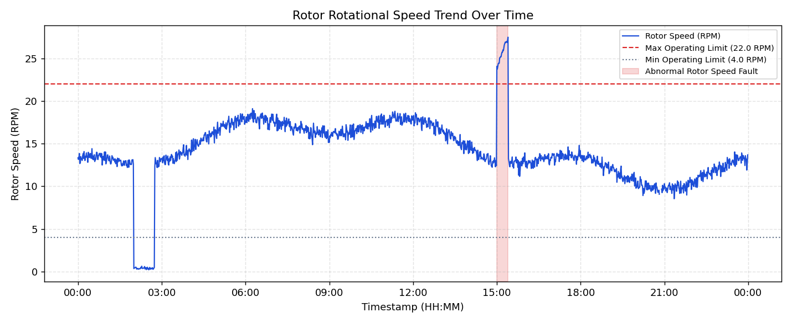
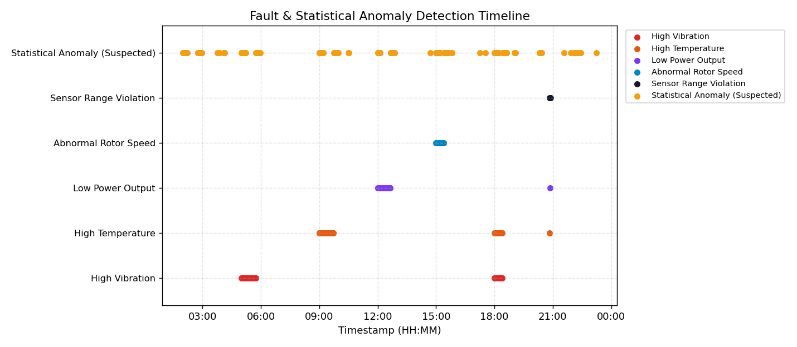
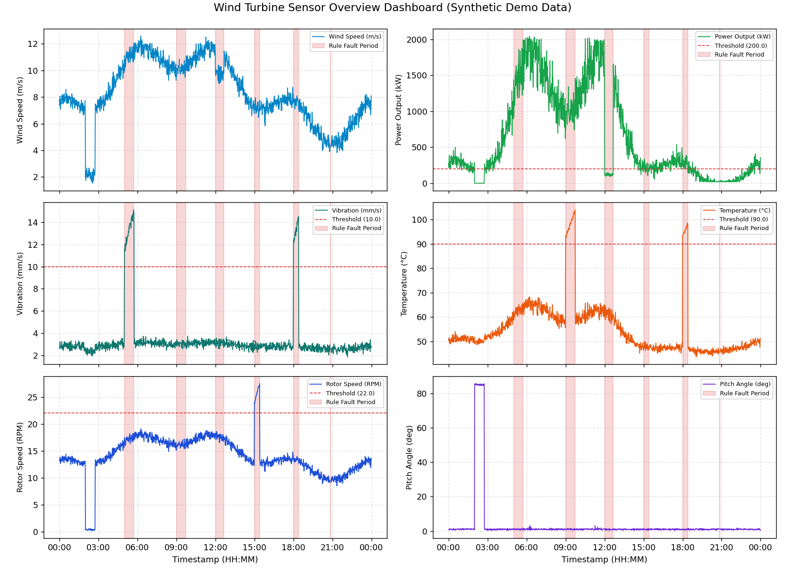
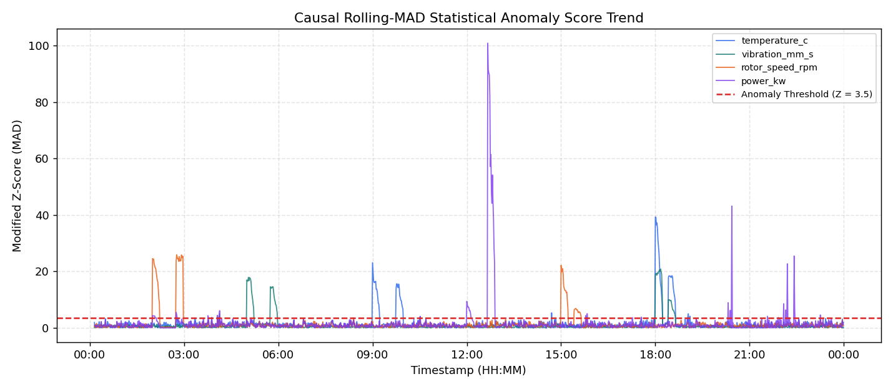

# Wind Turbine Condition Monitoring & Fault Detection Report

**Generated (UTC):** 2026-11-26T03:58:01.598943+00:00  
**Input Dataset:** `/working_dir/c_cb528a13594ab862/Wind-Turbine-Sensor-Data-Analysis-Fault-Detection/data/raw/wind_turbine_sensor_data.csv`  
**Analysis Window:** `2026-01-15T00:00:00` to `2026-01-15T23:59:00`  

> **Scope & Data Origin Notice:** Synthetic demonstration dataset (unless replaced with real SCADA CSV). Configured thresholds are illustrative engineering assumptions, not universal OEM specs. Statistical anomaly scores highlight suspected unusual operating behavior relative to recent rolling baselines and do **not** represent confirmed mechanical failures without physical inspection.

---

## 1. Project Overview
This report summarizes the automated execution of the **Wind Turbine Sensor Data Analysis & Fault Detection** pipeline. The pipeline validates raw sensor CSV data, audits data quality, applies transparent preprocessing, evaluates configurable rule-based engineering fault conditions, computes causal rolling-median / MAD statistical anomaly scores, and generates diagnostic visualizations.

## 2. Dataset Description & Records Analyzed
- **Raw Records Loaded:** 1442
- **Records Analyzed (Post-Preprocessing):** 1440
- **Operating State Breakdown:** `OPERATING` = 1395 records, `IDLE` = 45 records
- **Schema Status:** Valid

## 3. Data-Quality Findings & Preprocessing
- **Invalid Timestamps:** 0
- **Duplicate Timestamps Detected:** 2
- **Total Missing Values:** 12
- **Out-of-Range Physical Readings:** 4

**Quality Notes:**
- Detected 2 duplicate timestamp record(s) across 2 unique timestamp(s).
- Column 'wind_speed_mps' has 1 reading(s) outside configured physical limits [0.0, 50.0] m/s.
- Column 'temperature_c' has 1 reading(s) outside configured physical limits [-30.0, 150.0] C.
- Column 'vibration_mm_s' has 1 reading(s) outside configured physical limits [0.0, 50.0] mm/s.
- Column 'power_kw' has 1 reading(s) outside configured physical limits [-50.0, 3500.0] kW.

**Preprocessing Actions Applied:**
- Sorted records chronologically by timestamp.
- Removed 2 duplicate timestamp row(s) using strategy 'keep_first'.
- Retained missing sensor values as NaN ('retain' policy) to avoid masking sensor dropouts.

### Missing-Value Statistics
| Column | Missing Count |
| --- | ---: |
| `timestamp` | 0 |
| `wind_speed_mps` | 3 |
| `rotor_speed_rpm` | 0 |
| `generator_speed_rpm` | 0 |
| `temperature_c` | 3 |
| `vibration_mm_s` | 3 |
| `power_kw` | 3 |
| `torque_nm` | 0 |
| `pitch_angle_deg` | 0 |
| `status` | 0 |

## 4. Rule-Based Fault Detection Results
- **Timestamps with at Least One Rule Fault:** 184
- **Total Individual Fault Events:** 211
- **Timestamps with Simultaneous Multi-Faults:** 27
- **Severity Breakdown:** CRITICAL = 94, HIGH = 3, WARNING = 87, NONE = 1256

### Fault Categories
| Fault Category | Flagged Timestamps |
| --- | ---: |
| `HIGH_VIBRATION` | 70 |
| `HIGH_TEMPERATURE` | 71 |
| `LOW_POWER_OUTPUT` | 41 |
| `ABNORMAL_ROTOR_SPEED` | 25 |
| `SENSOR_RANGE_VIOLATION` | 4 |

## 5. Statistical Anomaly Detection (Causal Rolling MAD)
- **Rolling Window:** 30 records (`min_periods=10`)
- **Modified Z-Score Threshold:** 3.5
- **Total Suspected Anomalous Timestamps:** 192
- **Maximum Observed Anomaly Score:** 100.8933

| Monitored Sensor | Suspected Anomalous Timestamps |
| --- | ---: |
| `temperature_c` | 65 |
| `vibration_mm_s` | 56 |
| `rotor_speed_rpm` | 56 |
| `power_kw` | 55 |

## 6. Key Engineering Observations
- Within valid physical sensor bounds, peak vibration reached **15.12 mm/s**, peak operating temperature reached **104.00 °C**, and peak power output reached **2046.45 kW**.
- Normal low-wind `IDLE` periods (45 records) were excluded from low-power fault rules, preventing false-positive curtailment alerts during calm wind conditions.
- Physically impossible sensor readings (4 readings) were flagged as `SENSOR_RANGE_VIOLATION` while preserving raw values and excluding them from rolling MAD baselines.

## 7. Generated Visualizations
- `01_wind_speed_vs_power.png`: `reports/figures/01_wind_speed_vs_power.png`

  
- `02_vibration_trend.png`: `reports/figures/02_vibration_trend.png`

  
- `03_temperature_trend.png`: `reports/figures/03_temperature_trend.png`

  
- `04_rotor_speed_trend.png`: `reports/figures/04_rotor_speed_trend.png`

  
- `05_fault_detection_timeline.png`: `reports/figures/05_fault_detection_timeline.png`

  
- `06_sensor_overview_dashboard.png`: `reports/figures/06_sensor_overview_dashboard.png`

  
- `07_anomaly_score_trend.png`: `reports/figures/07_anomaly_score_trend.png`

  

## 8. Limitations
- Demonstrated on a deterministic synthetic dataset rather than live industrial SCADA telemetry.
- Fixed univariate thresholds do not capture complex multivariate aerodynamic or pitch-curve interactions across varying air density or turbulence regimes.
- Causal rolling MAD adapts to local windows; sustained gradual drift longer than the rolling window may be absorbed into the baseline.

## 9. Recommended Next Steps
1. Calibrate thresholds in `config/thresholds.json` against OEM turbine power curves and site-specific SCADA historical baselines.
2. Integrate real 10-minute or 1-minute SCADA CSV exports into `data/raw/` and run `python scripts/run_analysis.py --input <path>`.
3. Add multivariate power-curve residual modeling (e.g., binned wind-speed vs. expected power) once historical normal-operation SCADA data is available.
